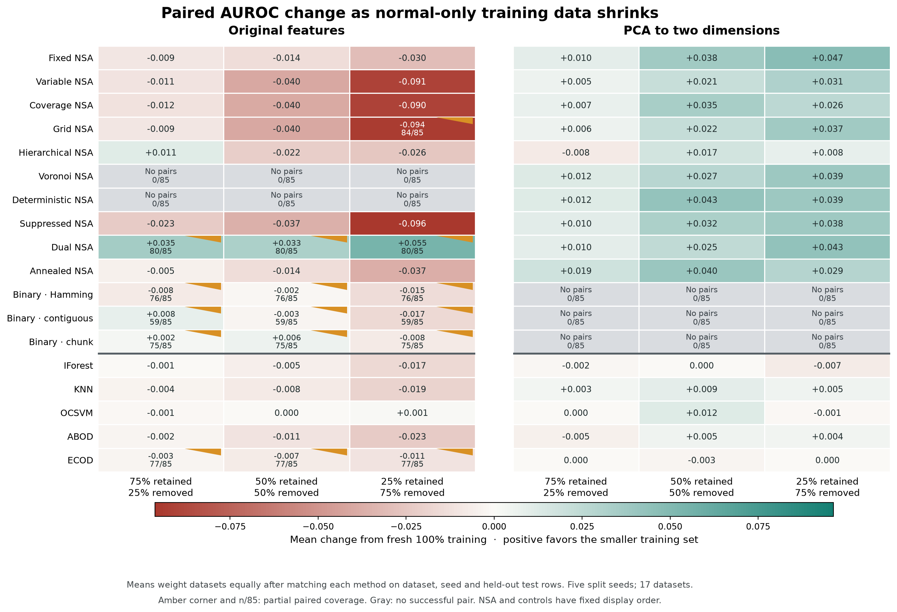

# Negative selection with scarce normal training data

This repository contains the code and experimental evidence for a benchmark
of negative selection algorithms (NSA) and PyOD detectors when training data
contains only normal observations. The experiment asks a practical question:
what happens when only a small part of the normal training pool is available?

Repository: <https://github.com/kishordgupta/pyod-nsa-normal-only-benchmark>

Authors: Kishor Datta Gupta and Dipankar Dasgupta.

## What the experiment found

Dual NSA became more competitive as the normal training pool shrank after
PCA to two dimensions. Its mean AUROC rose from 0.717 at full retention to
0.760 at 25% retention. At that size, it ranked 11th among the 36 configurations
that completed every dataset/seed run within the measured time budget. KNN
scored 0.800. NSA therefore improved without establishing overall superiority.
The gain was not general on original features, and Dual NSA's average precision
was almost unchanged (0.472 to 0.470).

The table below gives the dataset-level result for **25% retained normal
training data, no training outliers, and PCA(2)**. “Top position” is simply
`rank / 36 × 100`; smaller is better. Each score is the mean across five split
seeds, and all datasets use the same field of 36 eligible configurations.

| Dataset | Dual NSA AUROC | Rank / 36 | Top position |
| --- | ---: | ---: | ---: |
| Arrhythmia | 0.7113 | 3 / 36 | 8.3% |
| Cardio | 0.9274 | 11 / 36 | 30.6% |
| Glass | 0.9122 | 3 / 36 | 8.3% |
| Ionosphere | 0.7433 | 8 / 36 | 22.2% |
| Letter | 0.5155 | 17 / 36 | 47.2% |
| Lympho | 0.7310 | 19 / 36 | 52.8% |
| MNIST | 0.6448 | 21 / 36 | 58.3% |
| Musk | 0.9937 | 12 / 36 | 33.3% |
| Optdigits | 0.2992 | 26 / 36 | 72.2% |
| Pendigits | 0.9045 | 16 / 36 | 44.4% |
| Pima | 0.6606 | 18 / 36 | 50.0% |
| Satellite | 0.8179 | 6 / 36 | 16.7% |
| Satimage-2 | 0.9664 | 9 / 36 | 25.0% |
| Shuttle | 0.9834 | 2 / 36 | 5.6% |
| Vertebral | 0.4327 | 13 / 36 | 36.1% |
| Vowels | 0.7654 | 7 / 36 | 19.4% |
| WBC | 0.9153 | 10 / 36 | 27.8% |

These descriptive ranks vary across datasets and seeds. They are not a claim
that NSA is consistently in a fixed top percentile. The main comparison field
contains 10 NSA configurations and 26 other PyOD detectors. The companion CSV
also includes the rank against the 26 other detectors plus Dual NSA and a
sensitivity calculation with each dataset's locally eligible field.

## Protocol and scope

The primary fresh sweep has **17 ODDS datasets × 5 seeds × 2 feature
representations × 4 retention fractions × 56 configurations = 38,080 records**.
It includes all 11 NSA strategy families separately (13 configurations because
the binary family has three matching rules) and all 43 other registered tabular
PyOD methods at the pinned source revision. “All” refers to that declared
tabular roster, not graph, image, time-series or multimodal detectors.

For each seed, a stratified 60/40 split precedes removal of every anomalous
training row. The original normal training pool is capped at 600 observations
and the mixed test set at 2,000. The 100%, 75%, 50% and 25% subsets are nested.
Scaling and optional PCA are fitted only to the retained normals. Every
detector receives `fit(X)` without training labels. Test anomalies and labels
are used only to calculate AUROC and average precision.

The primary analysis qualifies a successful record when its measured
construction/import/fit plus scoring time is at most 15 seconds. Native code
sometimes swallowed the Python alarm, so this qualification is applied to the
recorded elapsed times after execution. All raw successes and their scores
remain available in a sensitivity analysis. Six stalled LOCI processes were
terminated after at least 600 seconds without raw-record progress; snapshot
and recovery evidence is retained. Two process restarts are also documented.
Failure and inapplicability are never scored as zero AUROC. Complete-coverage
rankings exclude methods without all 85 qualified dataset/seed runs.

XGBOD and DevNet require labeled outliers for their intended supervised
training, so they are inapplicable under this rule. Other errors, timeouts and
dimension restrictions are reported separately. Some query scoring methods
depend on the test feature batch; that limitation is audited explicitly.

The experiment is a bounded default-configuration benchmark, not a tuned
comparison or a proof about every normal-only learning regime. Retention is
relative to the capped normal training pool, rather than the full dataset.

## Find the evidence

| Path | Contents |
| --- | --- |
| [Full report](results/pyod_nsa_full_retention_report.md) | Main report, all-method summaries, paired comparisons and limitations |
| [Dataset ranks](results/pyod_nsa_dual_pca2_retain25_dataset_rank.csv) | Table above, per-seed ranks and comparison-field sensitivities |
| [Method summaries](results/pyod_nsa_full_retention_method_summary.csv) | AUROC, average precision, coverage and status counts for every setting |
| [Overall ranks](results/pyod_nsa_full_retention_coverage_qualified_ranks.csv) | Complete-coverage AUROC/AP rankings |
| [NSA versus other detectors](results/pyod_nsa_full_retention_nsa_vs_baseline.csv) | Matched comparisons and dataset-cluster bootstrap intervals |
| `benchmark/odds_oneclass/full_retention/raw/` | 680 primary JSONL files, 38,080 records |
| `benchmark/odds_oneclass/full_retention/logs/` | Public views of all primary process logs |
| `benchmark/odds_oneclass/full_retention/watchdog/` and `provenance/` | Snapshot and process-restart evidence |
| `benchmark/odds_oneclass/raw/`, `sensitivity/`, `retention/` | Earlier benchmark and retention experiments; historical, not additional primary runs |
| `benchmark/odds_oneclass/` | Runner, model constructors, sweep, analysis, plotting and packaging code |
| `vendor/pyod/` | Pinned PyOD source and tests, with upstream license |
| [Public copy manifest](provenance/public-copy-manifest.json) | Original/public file hashes and privacy changes |



## Reproduce from a clean clone

Use Python 3.12 on a POSIX system. The original execution used Python 3.12 on
macOS; elapsed times and occasional native-library failures are machine
dependent. Exact runtime versions are in `requirements.txt`, and the complete
observed environment is archived in `provenance/environment-requirements.txt`.
If a pinned wheel is unavailable for your platform, preserve the difference
in the new run manifest. The code uses POSIX alarms and does not provide the
same timeout behavior on Windows.

```bash
git clone https://github.com/kishordgupta/pyod-nsa-normal-only-benchmark.git
cd pyod-nsa-normal-only-benchmark
python3.12 -m venv .venv
source .venv/bin/activate
python -m pip install -r requirements.txt
python -m pip install --no-deps -e vendor/pyod
python scripts/fetch_datasets.py
python scripts/verify_public_tree.py
```

Verify a short execution before launching the full sweep:

```bash
python benchmark/odds_oneclass/runner.py \
  --data-dir vendor/pyod/notebooks/data --dataset glass --seed 42 \
  --representation pca2 --train-fraction 0.25 \
  --train-cap 600 --test-cap 2000 --method-timeout 15 \
  --method-filter nsa --results local_runs/smoke/glass_pca2_seed42_retain25.jsonl
```

Run the complete fresh grid into a new directory:

```bash
python benchmark/odds_oneclass/full_retention_sweep.py \
  --data-dir vendor/pyod/notebooks/data \
  --run-root local_runs/full_retention --workers 4
```

The sweep resumes missing records. It does not overwrite completed records.
Use a separate `--run-root` whenever changing the source, environment or
protocol. Keep the released `benchmark/.../raw` files as historical evidence.
The nominal alarm can be swallowed by native libraries; monitor long-running
cells. The original targeted recovery script is included as provenance but
requires a verified PID and exact preconditions before sending a signal.

Recompute the published full-grid analysis without fitting any model:

```bash
python benchmark/odds_oneclass/full_retention/analyze.py \
  --out-dir reanalysis/full_retention --bootstrap-reps 5000
python benchmark/odds_oneclass/full_retention/plot.py \
  --changes reanalysis/full_retention/full_retention_change_vs_full.csv \
  --output reanalysis/full_retention/full_retention_auroc_change.png
python benchmark/odds_oneclass/full_retention/dataset_rank_consistency.py
```

The last command regenerates the dataset-rank CSV/JSON in `results`. Plot
options are documented by `--help`. For a fresh run's analysis, the historical
watchdog and restart validation in the archived analyzer must be adapted to
the new run's observed interventions; do not copy old recovery events into a
new run. The archived analyzer is deliberately strict about the released
evidence and its exact 680-cell grid.

Public logs and metadata have host paths redacted. Original and public hashes
are recorded, and scientific fields are preserved. See
[publication privacy and portability notes](provenance/PORTABILITY_AND_PRIVACY.md)
and [third-party notices](THIRD_PARTY_NOTICES.md). Before publication, run
`python scripts/scan_public_tree.py`; it reports rule names and filenames,
never matched credential values.
