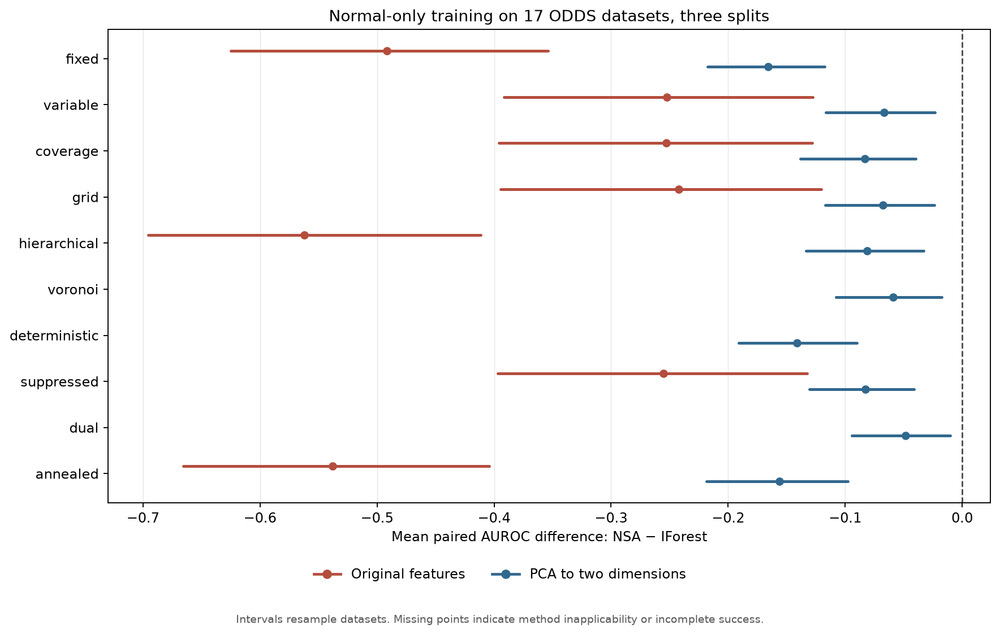

# PyOD NSA: normal-only training benchmark and PR evidence report

**Prepared 12 October 2026.** This is a local report for review; nothing was posted to GitHub. It evaluates the NSA implementation at PR #747's source tree `57ec5c9ea2800b559019adf0457d7e5b858fc153`.

## Result in brief

The requested clean-normal training condition was met in every recorded fit: **zero anomalous training rows**. Outliers remained in a separate held-out test partition. The results **do not establish general NSA superiority**. Most eligible PyOD detectors learned and scored with normal-only training data. Only XGBOD and DevNet in the 43-method tabular baseline roster require outlier labels for their intended supervised task.

| Three-split summary | Best fully observed NSA | Inductive comparators | Interpretation |
| --- | --- | --- | --- |
| Original features | NSA/grid 0.610 AUROC (51/51) | KNN 0.895; ABOD 0.892; IForest 0.852 (each 51/51) | NSA/dual reached 0.710 on 49/51 runs, so its mean has incomplete coverage. |
| PCA to 2D | NSA/dual 0.714 AUROC (51/51) | KNN 0.799; ABOD 0.791; OCSVM 0.784; IForest 0.762 (each 51/51) | NSA trails each of these predeclared inductive comparators. |

Means give each of the 17 datasets equal weight, with seeds 42–44 averaged within dataset. The complete 43-baseline/13-NSA, seed-42 screen and the 18-method/three-seed sensitivity panel appear below and in the attached machine-readable files.

## The 11 NSA strategy families, compared separately

| NSA family | Implemented mechanism | Original AUROC (runs) | PCA(2) AUROC (runs) |
| --- | --- | --- | --- |
| binary | Median-threshold bits; Hamming, contiguous-run, or chunk matching | hamming 0.528 (45/51); contiguous 0.557 (36/51); chunk 0.536 (45/51) | hamming — (0/51); contiguous — (0/51); chunk — (0/51) |
| fixed | Fixed-radius nonself spheres | 0.360 (51/51) | 0.597 (51/51) |
| variable | Nearest-self variable-radius spheres | 0.599 (51/51) | 0.696 (51/51) |
| coverage | Variable spheres with statistical coverage stopping | 0.599 (51/51) | 0.679 (51/51) |
| grid | Sparse spatial grid and radius filtering | 0.610 (51/51) | 0.695 (51/51) |
| hierarchical | Coarse-to-fine self clusters | 0.290 (51/51) | 0.681 (51/51) |
| voronoi | Bounded Voronoi centers in 2D or 3D | — (0/51) | 0.703 (51/51) |
| deterministic | 2D lattice with boundary repulsion | — (0/51) | 0.621 (51/51) |
| suppressed | Negative spheres plus reverse self detectors | 0.597 (51/51) | 0.680 (51/51) |
| dual | Cluster-ball envelope plus negative detectors | 0.710 (49/51) | 0.714 (51/51) |
| annealed | Monte Carlo population estimate plus position annealing | 0.314 (51/51) | 0.606 (51/51) |

This table compares the PR's **11 generation strategies** under the same normal-only training splits. Binary is one family with three matching rules, displayed separately instead of averaging away rule-specific failures. A score of “—” means no valid scored run. The 13-configuration tables below add AP and all failure outcomes. These are constructor-default strategies, not tuned optima.

## Data and protocol

1. **Source and coverage.** The 17 ODDS `.mat` datasets bundled in the [official PyOD benchmark notebook](https://github.com/yzhao062/pyod/blob/master/notebooks/benchmark.py) were checked against PyOD commit `ef6d5e8dc828615f498286c1d6a22cbd02fd4cd2`; the manifest records source URL and SHA-256 for every file. The tested roster is all 44 **shipped** tabular entries in the checked-out `algorithms.json`: 43 baselines plus NSA. The registry's planned LLMAD entry has no implementation in this checkout and was excluded as unavailable. NSA's 11 strategies become 13 configurations because binary matching has three rules.

2. **Split before fitting.** Each dataset used a 60/40 stratified train/test split. Every `y=1` row in the training partition was discarded. Up to 600 normal training rows and 2,000 held-out test rows were retained. For the test cap, stratified subsampling preserved the partition's approximate prevalence. Seeds 42, 43 and 44 were used in the sensitivity panel; the full roster used seed 42.

3. **Preprocessing.** StandardScaler was fit on normal training data only. The original-feature panel used all features. A second panel applied PCA to two components fit on normal training data only, allowing NSA's two-dimensional Voronoi and deterministic strategies to run. Test data were transformed by the already fit scaler/projector. PCA(2) can discard most variance, so those results describe a different representation.

4. **Models and metrics.** All attempted models received only `fit(X_normal)`, without `y`. They scored the same held-out, mixed-label test set with `decision_function`. AUROC and average precision (AP) were computed from the test labels after scoring. PyOD's default `contamination=0.1` was retained where applicable; this parameter did not supply anomalous training rows or labels. Ranked scores, rather than binary predictions, were evaluated. No hyperparameters were selected using test labels. A 15-second wall-time budget applied to each model/dataset attempt, including lazy import, construction, fit and score.

5. **Predeclared practical settings.** NSA used its constructor defaults (100 detectors and 10,000 candidate draws) except strategy, seed, and a fixed binary matching length of 40% of feature count for contiguous/chunk rules. Neighbor counts were bounded by the available normal training rows. LSCP used a fixed LOF/KNN/HBOS base list because it has no default list. To keep the CPU-wide screen feasible, DIF used 10 ensembles instead of 50; DeepSVDD 50 epochs instead of 100; AnoGAN 50 training and 5 query epochs instead of 500/20; ALAD 50 instead of 200; LUNAR 50 instead of 200. These changes limit paper-default comparisons. The code and exact versions are in the evidence bundle.

6. **Outcome accounting.** Every attempted method has a status. A timeout, geometry exclusion, or score error is never imputed as AUROC zero. The analysis checks one record for every planned method/dataset/representation cell, validates the zero-outlier fit count, and keeps failures in denominators. Reported runtime includes lazy import/construction; it is not a comparable fit-only speed benchmark.

## Main screen: complete method outcomes, seed 42

| Representation | Family | Planned records | Outcomes |
| --- | --- | --- | --- |
| Original features | NSA | 221 | error 10, requires_2d 17, requires_2d_or_3d 17, success 177 |
| Original features | baseline | 731 | error 2, requires_1d 17, requires_labeled_outliers 34, success 643, timeout 35 |
| PCA to 2D | NSA | 221 | error 51, success 170 |
| PCA to 2D | baseline | 731 | requires_1d 17, requires_labeled_outliers 34, success 659, timeout 21 |

The following tables include **every** configured NSA method and every tabular baseline. Cells show mean AUROC / mean AP and successful datasets out of 17. Means with fewer than 17 successes are conditional on success and should not be ranked against complete-coverage means. AP depends on the anomaly prevalence in each test split.

### NSA: 13 configurations

| NSA configuration | Original AUROC / AP (coverage) | PCA(2) AUROC / AP (coverage) |
| --- | --- | --- |
| NSA/annealed | 0.305 / 0.104 (17/17) | 0.586 / 0.319 (17/17) |
| NSA/binary/hamming | 0.519 / 0.150 (15/17) | error 17/17 |
| NSA/binary/rchunk | 0.526 / 0.120 (15/17) | error 17/17 |
| NSA/binary/rcontiguous | 0.531 / 0.197 (12/17) | error 17/17 |
| NSA/coverage | 0.604 / 0.296 (17/17) | 0.690 / 0.424 (17/17) |
| NSA/deterministic | requires_2d 17/17 | 0.625 / 0.347 (17/17) |
| NSA/dual | 0.728 / 0.497 (16/17) | 0.723 / 0.462 (17/17) |
| NSA/fixed | 0.427 / 0.166 (17/17) | 0.609 / 0.325 (17/17) |
| NSA/grid | 0.622 / 0.305 (17/17) | 0.707 / 0.442 (17/17) |
| NSA/hierarchical | 0.331 / 0.122 (17/17) | 0.696 / 0.417 (17/17) |
| NSA/suppressed | 0.605 / 0.300 (17/17) | 0.688 / 0.419 (17/17) |
| NSA/variable | 0.608 / 0.297 (17/17) | 0.708 / 0.453 (17/17) |
| NSA/voronoi | requires_2d_or_3d 17/17 | 0.716 / 0.449 (17/17) |

NSA/voronoi requires two or three features; NSA/deterministic requires exactly two. All original-feature ODDS files here have more than three features. All three binary matching rules failed to generate a usable detector in the PCA(2) panel. On original features, binary rules also failed on some datasets, and NSA/dual failed on MNIST. These are NSA applicability or implementation outcomes, not missing outlier labels.

### Other PyOD tabular methods: all 43 registry entries

| Method | Original AUROC / AP (coverage) | PCA(2) AUROC / AP (coverage) | Fit/score note |
| --- | --- | --- | --- |
| ABOD | 0.891 / 0.637 (17/17) | 0.794 / 0.458 (17/17) | pointwise |
| AE1SVM | 0.825 / 0.539 (17/17) | 0.673 / 0.345 (17/17) | pointwise |
| ALAD | 0.535 / 0.146 (17/17) | 0.476 / 0.121 (17/17) | stochastic |
| AnoGAN | 0.798 / 0.485 (17/17) | 0.650 / 0.264 (17/17) | pointwise |
| AutoEncoder | 0.867 / 0.593 (17/17) | 0.713 / 0.341 (17/17) | pointwise |
| CBLOF | 0.874 / 0.569 (17/17) | 0.788 / 0.440 (17/17) | pointwise |
| CD | 0.816 / 0.460 (16/17) | 0.613 / 0.302 (17/17) | batch |
| COF | 0.670 / 0.362 (17/17) | 0.613 / 0.213 (17/17) | batch |
| COPOD | 0.784 / 0.458 (17/17) | 0.679 / 0.308 (17/17) | batch |
| DIF | 0.829 / 0.474 (17/17) | 0.742 / 0.379 (17/17) | batch |
| DeepSVDD | 0.866 / 0.587 (17/17) | 0.718 / 0.362 (17/17) | pointwise |
| DevNet | requires_labeled_outliers 17/17 | requires_labeled_outliers 17/17 | requires anomaly labels |
| ECOD | 0.778 / 0.466 (17/17) | 0.629 / 0.268 (17/17) | batch |
| FeatureBagging | 0.882 / 0.587 (17/17) | 0.755 / 0.424 (17/17) | pointwise |
| GMM | 0.864 / 0.550 (17/17) | 0.653 / 0.349 (17/17) | pointwise |
| HBOS | 0.815 / 0.493 (17/17) | 0.756 / 0.388 (17/17) | pointwise |
| HDBSCAN | 0.682 / 0.223 (17/17) | 0.689 / 0.225 (17/17) | pointwise |
| IForest | 0.848 / 0.513 (17/17) | 0.766 / 0.406 (17/17) | pointwise |
| INNE | 0.870 / 0.585 (17/17) | 0.774 / 0.438 (17/17) | pointwise |
| KDE | 0.902 / 0.664 (17/17) | 0.800 / 0.469 (17/17) | pointwise |
| KNN | 0.897 / 0.624 (17/17) | 0.794 / 0.469 (17/17) | pointwise |
| KPCA | 0.903 / 0.658 (17/17) | 0.795 / 0.472 (17/17) | pointwise |
| LMDD | 0.758 / 0.463 (12/17) | 0.556 / 0.262 (17/17) | batch |
| LOCI | 0.714 / 0.287 (6/17) | 0.630 / 0.236 (6/17) | batch |
| LODA | 0.770 / 0.414 (17/17) | 0.711 / 0.315 (17/17) | pointwise |
| LOF | 0.881 / 0.583 (17/17) | 0.771 / 0.426 (17/17) | pointwise |
| LSCP | 0.893 / 0.598 (17/17) | 0.790 / 0.445 (17/17) | stochastic |
| LUNAR | 0.904 / 0.696 (17/17) | 0.786 / 0.430 (17/17) | pointwise |
| MAD | requires_1d 17/17 | requires_1d 17/17 | one feature only |
| MCD | 0.839 / 0.472 (17/17) | 0.725 / 0.372 (17/17) | pointwise |
| MO_GAAL | 0.512 / 0.236 (17/17) | 0.552 / 0.271 (17/17) | pointwise |
| OCSVM | 0.843 / 0.583 (17/17) | 0.789 / 0.464 (17/17) | pointwise |
| PCA | 0.797 / 0.524 (16/17) | 0.665 / 0.369 (17/17) | pointwise |
| QMCD | 0.538 / 0.241 (17/17) | 0.666 / 0.343 (17/17) | pointwise |
| RGraph | 0.442 / 0.203 (6/17) | 0.459 / 0.158 (7/17) | batch |
| ROD | 0.825 / 0.504 (9/17) | 0.677 / 0.306 (17/17) | batch |
| SOD | 0.757 / 0.371 (17/17) | 0.584 / 0.211 (17/17) | batch |
| SOS | 0.555 / 0.178 (17/17) | 0.504 / 0.166 (17/17) | batch |
| SO_GAAL | 0.519 / 0.252 (17/17) | 0.562 / 0.237 (17/17) | pointwise |
| SUOD | 0.848 / 0.546 (17/17) | 0.759 / 0.400 (17/17) | batch |
| Sampling | 0.860 / 0.565 (17/17) | 0.783 / 0.446 (17/17) | pointwise |
| VAE | 0.824 / 0.563 (17/17) | 0.702 / 0.371 (17/17) | stochastic |
| XGBOD | requires_labeled_outliers 17/17 | requires_labeled_outliers 17/17 | requires anomaly labels |

“Batch” means this implementation's score for a query may depend on other query rows; those rows were unlabeled, but this is not the same strictly inductive pointwise task as NSA. The batch-dependent group is COF, LOCI, SOS, SOD, ECOD, COPOD, RGraph, SUOD, LMDD, DIF, CD and ROD. VAE, LSCP and ALAD have stochastic or call-order-sensitive inference here. The four predeclared repeated-run inductive comparators were IForest, OCSVM, KNN and ABOD; ECOD was repeated as a batch-dependent comparator.

For the original-feature screen, the best *fully observed* NSA method was grid (0.622), while LUNAR, KPCA, KDE, KNN and ABOD scored 0.904, 0.903, 0.902, 0.897 and 0.891, respectively, each on all 17 datasets. NSA/dual scored 0.728 on 16/17. For PCA(2), NSA/dual scored 0.723 versus KDE 0.800, KPCA 0.795, ABOD 0.794 and KNN 0.794, each on all 17.

## Per-dataset screen: descriptive best observed strategy

These tables select each family's best method **after reading test labels**. They are optimistic diagnostics, not a usable strategy-selection procedure. Eligible baseline selection excludes the batch-dependent methods above. The listed test anomaly count is from seed 42 and can be very small.

### Original features

| Dataset | Features | Fit normals | Test anomalies | Variance kept | Best NSA | Best inductive baseline | NSA − baseline |
| --- | --- | --- | --- | --- | --- | --- | --- |
| arrhythmia | 274 | 231 | 26 | 1.000 | binary/rchunk 0.613 | LUNAR 0.837 | -0.224 |
| cardio | 21 | 600 | 70 | 1.000 | suppressed 0.886 | OCSVM 0.967 | -0.081 |
| glass | 9 | 123 | 4 | 1.000 | dual 0.838 | KPCA 0.848 | -0.009 |
| ionosphere | 33 | 135 | 51 | 1.000 | dual 0.881 | KNN 0.989 | -0.108 |
| letter | 32 | 600 | 40 | 1.000 | grid 0.695 | LUNAR 0.910 | -0.215 |
| lympho | 18 | 84 | 2 | 1.000 | binary/rcontiguous 1.000 | ABOD 1.000 | +0.000 |
| mnist | 100 | 600 | 184 | 1.000 | binary/hamming 0.702 | KPCA 0.940 | -0.238 |
| musk | 166 | 600 | 39 | 1.000 | dual 1.000 | ABOD 1.000 | +0.000 |
| optdigits | 64 | 600 | 57 | 1.000 | coverage 0.847 | LUNAR 0.987 | -0.140 |
| pendigits | 16 | 600 | 45 | 1.000 | grid 0.862 | LUNAR 0.999 | -0.137 |
| pima | 8 | 299 | 107 | 1.000 | hierarchical 0.619 | KDE 0.723 | -0.105 |
| satellite | 36 | 600 | 632 | 1.000 | dual 0.686 | LSCP 0.894 | -0.208 |
| satimage-2 | 36 | 600 | 24 | 1.000 | dual 0.966 | KNN 0.999 | -0.033 |
| shuttle | 9 | 600 | 143 | 1.000 | dual 0.999 | INNE 0.999 | -0.000 |
| vertebral | 6 | 126 | 12 | 1.000 | fixed 0.680 | MO_GAAL 0.648 | +0.032 |
| vowels | 12 | 600 | 20 | 1.000 | grid 0.907 | ABOD 0.993 | -0.086 |
| wbc | 30 | 213 | 8 | 1.000 | binary/rchunk 0.662 | AutoEncoder 0.966 | -0.304 |

### PCA to 2D

| Dataset | Features | Fit normals | Test anomalies | Variance kept | Best NSA | Best inductive baseline | NSA − baseline |
| --- | --- | --- | --- | --- | --- | --- | --- |
| arrhythmia | 274 | 231 | 26 | 0.162 | suppressed 0.578 | Sampling 0.639 | -0.061 |
| cardio | 21 | 600 | 70 | 0.459 | deterministic 0.950 | INNE 0.942 | +0.008 |
| glass | 9 | 123 | 4 | 0.544 | hierarchical 0.884 | CBLOF 0.863 | +0.021 |
| ionosphere | 33 | 135 | 51 | 0.694 | suppressed 0.757 | CBLOF 0.840 | -0.083 |
| letter | 32 | 600 | 40 | 0.382 | dual 0.341 | DeepSVDD 0.707 | -0.365 |
| lympho | 18 | 84 | 2 | 0.343 | voronoi 0.966 | AE1SVM 0.974 | -0.009 |
| mnist | 100 | 600 | 184 | 0.214 | deterministic 0.608 | PCA 0.829 | -0.222 |
| musk | 166 | 600 | 39 | 0.460 | coverage 0.999 | OCSVM 1.000 | -0.001 |
| optdigits | 64 | 600 | 57 | 0.244 | dual 0.434 | CBLOF 0.748 | -0.314 |
| pendigits | 16 | 600 | 45 | 0.494 | variable 0.953 | QMCD 0.989 | -0.036 |
| pima | 8 | 299 | 107 | 0.475 | dual 0.628 | MCD 0.691 | -0.064 |
| satellite | 36 | 600 | 632 | 0.887 | dual 0.829 | KDE 0.861 | -0.032 |
| satimage-2 | 36 | 600 | 24 | 0.858 | hierarchical 0.957 | LSCP 0.986 | -0.029 |
| shuttle | 9 | 600 | 143 | 0.601 | dual 0.955 | ABOD 0.990 | -0.035 |
| vertebral | 6 | 126 | 12 | 0.736 | deterministic 0.483 | PCA 0.630 | -0.147 |
| vowels | 12 | 600 | 20 | 0.550 | hierarchical 0.363 | LSCP 0.863 | -0.500 |
| wbc | 30 | 213 | 8 | 0.561 | dual 0.884 | LUNAR 0.958 | -0.075 |

The hindsight NSA winner beat the hindsight eligible baseline on 1 of 17 original-feature datasets (vertebral), tied on two (lympho, musk), and lost on 14. In PCA(2), it won on two (cardio, glass) and lost on 15. The glass test split contains only four anomalies; lympho contains two.

## Three-split sensitivity and paired uncertainty

The prespecified repeated subset was all 13 NSA configurations and IForest, ECOD, OCSVM, KNN and ABOD on seeds 42–44. This is 17 datasets × 18 configurations × 3 seeds × 2 representations = **1,836 validated records**. Means below average seed scores within dataset, then give each dataset equal weight. Coverage is successful runs out of 51.

| Method | Original AUROC / AP (coverage) | PCA(2) AUROC / AP (coverage) |
| --- | --- | --- |
| NSA/fixed | 0.360 / 0.128 (51/51) | 0.597 / 0.337 (51/51) |
| NSA/variable | 0.599 / 0.304 (51/51) | 0.696 / 0.444 (51/51) |
| NSA/coverage | 0.599 / 0.304 (51/51) | 0.679 / 0.427 (51/51) |
| NSA/grid | 0.610 / 0.311 (51/51) | 0.695 / 0.439 (51/51) |
| NSA/hierarchical | 0.290 / 0.105 (51/51) | 0.681 / 0.421 (51/51) |
| NSA/voronoi | — / — (0/51) | 0.703 / 0.450 (51/51) |
| NSA/deterministic | — / — (0/51) | 0.621 / 0.362 (51/51) |
| NSA/suppressed | 0.597 / 0.300 (51/51) | 0.680 / 0.426 (51/51) |
| NSA/dual | 0.710 / 0.461 (49/51) | 0.714 / 0.465 (51/51) |
| NSA/annealed | 0.314 / 0.110 (51/51) | 0.606 / 0.361 (51/51) |
| NSA/binary/hamming | 0.528 / 0.150 (45/51) | — / — (0/51) |
| NSA/binary/rcontiguous | 0.557 / 0.166 (36/51) | — / — (0/51) |
| NSA/binary/rchunk | 0.536 / 0.125 (45/51) | — / — (0/51) |
| IForest | 0.852 / 0.518 (51/51) | 0.762 / 0.402 (51/51) |
| ECOD | 0.782 / 0.468 (51/51) | 0.621 / 0.268 (51/51) |
| OCSVM | 0.843 / 0.562 (51/51) | 0.784 / 0.473 (51/51) |
| KNN | 0.895 / 0.610 (51/51) | 0.799 / 0.483 (51/51) |
| ABOD | 0.892 / 0.627 (51/51) | 0.791 / 0.477 (51/51) |

### Paired NSA − IForest AUROC

| NSA method | Original mean [95% interval] (pairs) | PCA(2) mean [95% interval] (pairs) |
| --- | --- | --- |
| NSA/fixed | -0.492 [-0.625, -0.354] (51/51) | -0.166 [-0.217, -0.118] (51/51) |
| NSA/variable | -0.252 [-0.392, -0.128] (51/51) | -0.067 [-0.117, -0.023] (51/51) |
| NSA/coverage | -0.253 [-0.396, -0.128] (51/51) | -0.083 [-0.138, -0.040] (51/51) |
| NSA/grid | -0.242 [-0.394, -0.121] (51/51) | -0.068 [-0.117, -0.024] (51/51) |
| NSA/hierarchical | -0.562 [-0.696, -0.411] (51/51) | -0.081 [-0.134, -0.033] (51/51) |
| NSA/voronoi | — | -0.059 [-0.108, -0.017] (51/51) |
| NSA/deterministic | — | -0.141 [-0.191, -0.090] (51/51) |
| NSA/suppressed | -0.255 [-0.397, -0.133] (51/51) | -0.083 [-0.131, -0.041] (51/51) |
| NSA/dual | -0.142 [-0.221, -0.067] (49/51) | -0.048 [-0.094, -0.010] (51/51) |
| NSA/annealed | -0.538 [-0.666, -0.404] (51/51) | -0.156 [-0.218, -0.098] (51/51) |
| NSA/binary/hamming | -0.361 [-0.442, -0.279] (45/51) | — |
| NSA/binary/rcontiguous | -0.339 [-0.406, -0.271] (36/51) | — |
| NSA/binary/rchunk | -0.353 [-0.397, -0.301] (45/51) | — |

Intervals are percentile bootstrap intervals from 5,000 resamples of the **17 datasets**, preserving the matched seeds inside each dataset. They describe uncertainty across datasets; they are unadjusted and should not be read as multiple-comparison tests. Every complete-coverage NSA–IForest AUROC interval is below zero in both representations. NSA/dual versus IForest was −0.142 [−0.221, −0.067] on 49/51 original-feature pairs and −0.048 [−0.094, −0.010] on all 51 PCA(2) pairs. The PCA(2) dual AP mean, 0.465, was above IForest's 0.402; KNN, ABOD and OCSVM had higher AP means of 0.483, 0.477 and 0.473. AP is metric- and prevalence-sensitive, so this does not reverse the AUROC result.

## Which PyOD detectors need outlier training labels?

Within the **complete 43-entry tabular baseline registry used here**, the methods whose intended supervised training needs labeled anomalous examples are **XGBOD** and **DevNet**. Both have a required `y` argument and `fit(X_normal)` raised `TypeError` in a separate 24-normal-row execution probe. Each was recorded as `requires_labeled_outliers` in 17 original-feature and 17 PCA(2) cells, for **34 cells per method**. No test labels were passed into their training.

The all-zero-label probe is an important qualification: `fit(X_normal, y=zeros)` **did execute** for both. XGBOD exposed only class 0 and gave one constant anomaly score on the 24 rows. DevNet ran one epoch and returned varying scores despite reporting zero outliers. Thus the exact claim is that they **cannot be trained for their intended labeled-outlier discrimination under this protocol**, not that every possible all-zero call throws. The probe results and constructor settings are saved separately.

The other 41 baseline registry entries do not require anomaly examples at fit time. Some, including LUNAR and the GAAL variants, create synthetic negative examples internally from normal-only data; this obeys the restriction on using real dataset outliers during training. Non-tabular wrappers such as EmbeddingOD and MultiModalOD may inherit a label requirement if configured with XGBOD or DevNet, but they add no separate always-label-dependent detector to this tabular roster. The registered graph-only SCAN_Graph detector accepts optional `y` but needs graph structure, so it was also outside this tabular benchmark. MAD was excluded here because it accepts a single feature, not because it needs outliers. LOCI, RGraph, ROD and LMDD had 15-second timeouts; CD and PCA had isolated nonfinite-score errors in the original-feature panel. These outcomes do **not** imply that the methods need anomalous training rows. PyOD explicitly distinguishes [novelty detection from outlier detection](https://pyod.readthedocs.io/en/latest/relevant_knowledge.html), and its [API documentation](https://pyod.readthedocs.io/en/latest/) notes that `y` is ignored by unsupervised detectors.

## Interpretation for PR #747

The [open PR](https://github.com/yzhao062/pyod/pull/747) review asks for a defined operating regime and evidence. This experiment supplies the requested clean-normal training test, but it **cannot support a broad claim that NSA is superior because other PyOD detectors cannot work without training outliers**. Many competitors succeeded.

There are exploratory, dataset-specific leads: on PCA(2) cardio, NSA/deterministic averaged 0.942 AUROC over the three selected splits versus IForest 0.928, while the single-split all-baseline best was INNE at 0.942 versus NSA/deterministic 0.950. On original-feature vertebral, NSA/fixed averaged 0.554 versus IForest 0.431, but its absolute discrimination was weak. On glass the seed-42 PCA(2) oracle NSA advantage used only four anomalous test rows. These observations need a prospective strategy rule and more data before becoming an operating-regime claim.

The report addresses the reviewer's evidence question only. The separate requests to remove the package-level NSA export and reduce the PR's size remain code-review work. No GitHub comment, commit, or PR update was made while preparing this report.

## Limitations and evidence files

- The 600-normal-row and 2,000-test-row caps, 15-second budget and reduced deep-model budgets favor tractable breadth over paper-default optimization. Methods were not individually tuned.

- PCA(2) retained only 16.2% of normal-training variance for arrhythmia, 21.4% for MNIST and 24.4% for optdigits; inspect the per-dataset table before generalizing its results back to the original feature space.

- Some PyOD `decision_function` implementations use the whole unlabeled query batch, so batch-dependent baselines do not measure the exact same inductive prediction task. Test labels were never used for model fitting.

- The best-per-dataset tables select with held-out labels and deliberately overstate what a deployable selection policy could achieve. Rare test anomalies make some individual dataset comparisons unstable.

- This is a fixed PyOD source-tree snapshot and an explicitly specified CPU screen, not a claim about every future PyOD release or every hyperparameter setting. PYTHONPATH resolved to the checked-out PR source reporting version 3.6.6; the virtual environment's installed-distribution metadata reports 3.6.5. The source tree hash is the controlling implementation identifier.

The accompanying CSVs include all 1,904 primary outcomes, both panels' 56-method summaries, per-dataset diagnostics, all primary NSA–baseline pairings, the 1,836 repeated-run records, and all repeated-run pairings. The reproducibility ZIP includes raw JSONL records, scripts, manifests, and the synthetic supervised probe. Original ODDS data bytes are linked and hashed in the dataset manifest, rather than repackaged.
